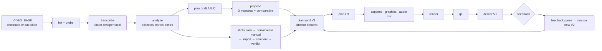

# Arquitectura

EditorIA es una CLI en Python (`editoria`) que ejecuta el flujo del prompt maestro, más una capa de agentes para Claude Code (`.claude/`) que la opera como director creativo y editor.

## Principios

1. **El reloj maestro es el audio del VIDEO_BASE.** Nada altera la duración ni el orden. Reencuadres, tomas generadas y gráficos reemplazan o se superponen a la imagen en intervalos `[in, out]`; el audio siempre es el original, con SFX y música opcional por debajo.
2. **Plan declarativo.** Toda edición se describe en `plan.yaml` (Pydantic + linter de políticas). El render es una función del plan y los medios: reproducible, versionable y comparable.
3. **El modelo decide; el código ejecuta y verifica.** Las reglas del prompt son chequeos ([políticas](politicas.md)).
4. **Nada se sobrescribe.** El original es de solo lectura y tiene hash; las versiones son inmutables (V1, V2…).
5. **Local primero y sin red durante el render.** Los gráficos bloquean `http(s)`; fuentes y assets son locales; la transcripción corre en la máquina.
6. **Procedencia explícita.** Cada intervalo declara su método (`original`, `reframe`, `generated`) y cada asset su licencia.

## Flujo



## Módulos

| Módulo | Responsabilidad |
|---|---|
| `schemas/` | Modelos Pydantic v2 estrictos (`extra="forbid"`): proyecto, probe, transcript, segmentos, plan, estilo, marca, QC, feedback, assets. Exporta JSON Schema a `schemas/json/` |
| `contracts.py` | Interfaces (`Protocol`) entre módulos: `CaptionBuilder`, `GraphicsRenderer`, `AudioMixer`, `ShotLibrary`, `PlanTools`, `Renderer`, `QualityControl` |
| `util/` | `ffmpeg` (toda llamada pasa por `run()`/`probe()`), `project` (`ProjectContext`: todas las rutas), `geometry`, `files`, `log`, `resources` |
| `ingest/`, `analysis/`, `versioning/`, `doctor.py` | `doctor`, `init`, `probe`, `transcribe`, `analyze`, `version new`, `feedback parse` |
| `planning/`, `policy/`, `captions/` | Borrador del plan, linter de políticas, subtítulos ASS/SRT/VTT |
| `graphics/` | Plantillas HTML/CSS renderizadas con Playwright/Chromium a secuencias PNG con alfa ([ADR-0001](adr/0001-motor-de-graficos.md)) |
| `audio/` | SFX propios, mezcla con loudness, verificación de voz |
| `shots/` | Tomas complementarias: paquete, importación, comparación, veredicto, presupuesto ([ADR-0003](adr/0003-higgsfield-manual.md)) |
| `render/`, `qc/` | Composición con FFmpeg, hoja de contactos, control de calidad |
| `pipeline.py`, `deliver.py` | `propose`, `run`, `deliver` |

Cada módulo expone `cli.register(app)`; el `cli.py` raíz los monta.

## Espacio de trabajo por video

```
proyectos/<slug>/
├─ proyecto.yaml       marca, destino, presupuesto, modo de propuesta, límites de herramientas
├─ 00_original/        video_base.mp4 + .sha256 · solo lectura
├─ 01_analisis/        probe · transcript · transcript_revision.md · silencios · cortes · rostro
│                      segmentos.json · mapa_edicion.csv
├─ 02_tomas/           higgsfield/paquetes · higgsfield/resultados · comparativas · registro_generaciones.csv
├─ 03_propuestas/      plan_A|B|C.yaml · muestra_A|B|C.mp4 · comparativa_ABC.mp4 · propuestas.md
├─ 04_versiones/V1/    plan.yaml · video.mp4 · subtitulos.* · graficos/ · audio/ · qc/ · resumen.md
│                      atribuciones.md · mapa_edicion.csv · .entregado
└─ logs/               comandos.jsonl · creditos.jsonl
```

`proyectos/` está en `.gitignore`: contiene medios de quien usa la herramienta y nunca se versiona.

## El plan (`plan.yaml`)

Describe sobre la línea de tiempo del VIDEO_BASE: intervalos de video con su método, subtítulos con énfasis, gráficos (plantilla o emoji), efectos de sonido, música opcional y la mezcla. Formato completo en [`.claude/skills/editar-video/references/plan-yaml.md`](../.claude/skills/editar-video/references/plan-yaml.md) y en `schemas/json/plan.schema.json`.

## Capas del render

Orden de composición: video base → reencuadres y tomas generadas → gráficos (secuencias PNG con alfa) → emojis animados → subtítulos ASS al final. Audio: el del VIDEO_BASE más SFX (y música opcional con ducking), normalizado a −14 LUFS / −1 dBTP por defecto, sin otro procesamiento sobre la voz.

Los filtros con archivos se ejecutan con `cwd` en la carpeta de la versión y rutas relativas, para soportar rutas con espacios y acentos en Windows.

## Capa de agentes (`.claude/`)

| Pieza | Qué hace |
|---|---|
| `skills/editar-video/` | Flujo completo hasta V1 mapeado a comandos, decisiones del director, lectura de QC; se detiene tras V1 |
| `skills/aplicar-feedback/` | Feedback con tiempos → nueva versión sin sobrescribir |
| `agents/` | `director-creativo`, `operador-tomas`, `motion-designer`, `disenador-sonido`, `revisor-qc` (solo lectura) |
| `hooks/` | `proteger_original.py`, `guardar_presupuesto.py` |
| `settings.json` | Permisos y registro de hooks |

## Recursos y licencias

- `brands/`: perfiles de marca (`master-solution` es provisional; `_plantilla` para crear la tuya).
- `styles/`: presets A/B/C (subtítulos, políticas de gráficos y SFX, reencuadre).
- `templates/graphics/`: plantillas de motion graphics. `templates/docs/`: plantillas de trabajo.
- `assets/sfx/`: SFX sintetizados propios (CC0). `assets/externos.yaml`: manifest de emojis Noto e Inter; los archivos los descarga `scripts/fetch_assets.py`.
- `references/`: patrones de edición R01–R09 (solo texto) y enlaces web W01–W25.

Detalle de licencias en [THIRD_PARTY.md](../THIRD_PARTY.md) y [ADR-0004](adr/0004-licencias.md).
